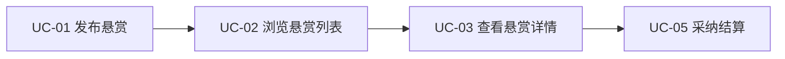
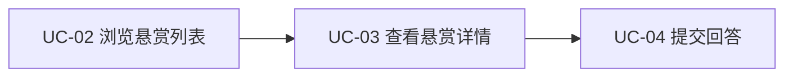
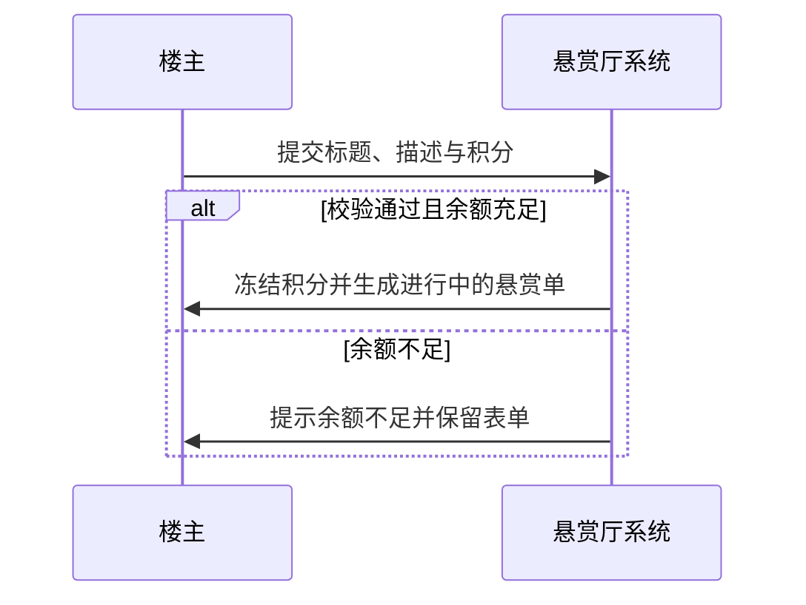
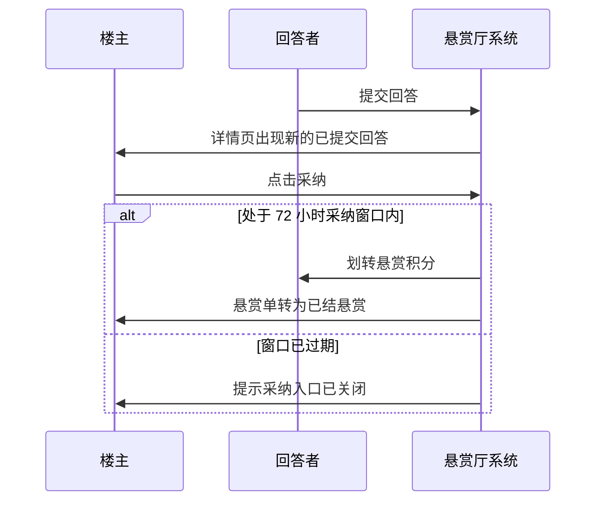
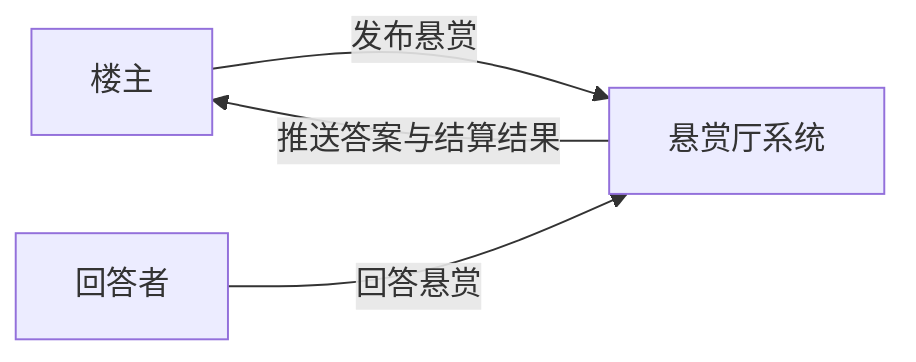

# 悬赏厅最小卷 · 业务架构

> 版本 v1 · 2099-01-01 · 摘要：最小卷的业务域、用例总览、两段核心流程与业务规则、系统上下文

## 1 背景与成功度量

承接原始需求 §1：把群里吼问题变成积分悬赏交易，最小卷只做发布、回答、采纳结算一个闭环。上线 8 周内验收三条数字：悬赏发布量每月 120 单以上、悬赏 48 小时首答率不低于 85%、有回答悬赏的采纳结算率不低于 70%。

## 2 业务域划分

| 业务域 | 职责 | 关键实体 |
| --- | --- | --- |
| 悬赏发布域 | 表单校验、积分冻结、建单 | 悬赏单、积分账户 |
| 悬赏大厅域 | 列表浏览、详情查看 | 悬赏单 |
| 回答采纳域 | 回答提交、采纳分流与结算 | 回答单、积分账户 |

## 3 用例与流程

### 3.0 用例总览

| 用例 | 业务域 | 用例名 | 参与角色 | 所属流程 | 关联 FR |
| --- | --- | --- | --- | --- | --- |
| UC-01 | 悬赏发布域 | 发布悬赏 | 楼主 | §3.2 | FR-01 |
| UC-02 | 悬赏大厅域 | 浏览悬赏列表 | 楼主、回答者 | §3.2 | FR-01 |
| UC-03 | 悬赏大厅域 | 查看悬赏详情 | 楼主、回答者 | §3.3 | FR-02 |
| UC-04 | 回答采纳域 | 提交回答 | 回答者 | §3.3 | FR-02 |
| UC-05 | 回答采纳域 | 采纳结算 | 楼主 | §3.3 | FR-03 |

### 3.1 每角色用例视图

#### 楼主

楼主发起悬赏并收口结算，名下用例全集如下：

#### 回答者

回答者从列表发现悬赏并交付回答，名下用例全集如下：

### 3.2 悬赏发布流程

步骤：

1. 楼主在悬赏列表点「发布悬赏」，展开表单；
2. 填写标题、描述、积分，系统逐项校验；
3. 校验通过后冻结等额积分，悬赏单由草稿转为进行中，回到列表。

业务规则：

- BR-01：积分为 10 至 500 的整数，超出区间拒绝提交；
- BR-02：标题不少于 5 个字，否则不允许建单；
- BR-03：积分冻结成功才允许建单，冻结失败时表单内容保留。

### 3.3 回答与采纳流程

步骤：

1. 回答者从列表进入详情，查看悬赏全文与既有回答；
2. 提交非空回答，回答单进入已提交状态；
3. 楼主在采纳窗口内点选一条回答，系统一步完成分流与划账。

业务规则：

- BR-04：仅悬赏状态为进行中时接受回答；
- BR-05：一张悬赏单至多一条已采纳回答，采纳时其余回答自动转为未采纳；
- BR-06：采纳窗口为发布后 72 小时，过期后采纳入口关闭。

## 4 状态与账本口径

悬赏单与回答单状态机见信息架构 §2。积分划转采用冻结、划转两步记账，发布即冻结、采纳即划转，两步都在页面上展示数值，不出现两边同时扣减的中间态。

## 5 系统上下文

上下文只含两个角色与一个系统：楼主、回答者与悬赏厅系统。楼主发布悬赏并接收答案与结算结果，回答者浏览悬赏并提交回答。模型源文件为 4A架构/model.c4，本图与其标题一一对应。
