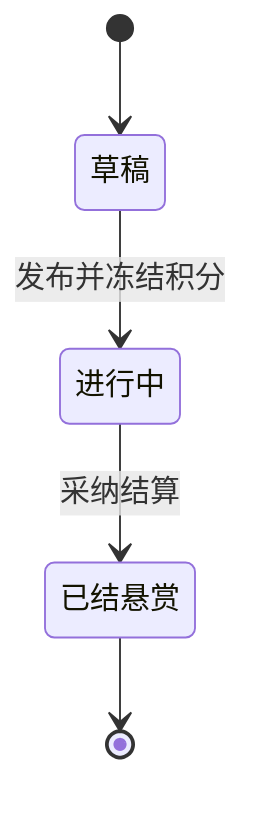
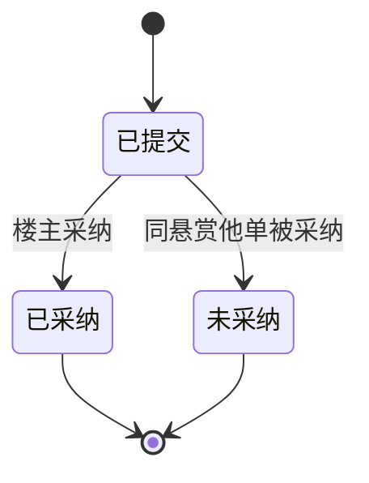

# 悬赏厅最小卷 · 信息架构

> 版本 v1 · 2099-01-01 · 摘要：两张单据的实体、字段、状态机与可见性

## 1 实体清单

| 实体 | 说明 | 关键字段 | 状态集 |
| --- | --- | --- | --- |
| 悬赏单 | 楼主发起的悬赏载体 | 标题、描述、积分、楼主、发布时间、采纳截止时间 | 草稿、进行中、已结悬赏 |
| 回答单 | 回答者提交的回答载体 | 内容、回答者、所属悬赏、提交时间 | 已提交、已采纳、未采纳 |

## 2 状态机

### 2.1 悬赏单状态机

### 2.2 回答单状态机

## 3 字段可见性

| 字段 | 楼主可见 | 回答者可见 | 说明 |
| --- | --- | --- | --- |
| 标题、积分、状态 | 是 | 是 | 列表卡片与详情头部都展示 |
| 描述全文 | 是 | 是 | 详情页展示 |
| 回答内容 | 是 | 是 | 详情页按提交时间正序展示 |
| 积分划转数值 | 是 | 是 | 采纳结算后展示到账提示 |
