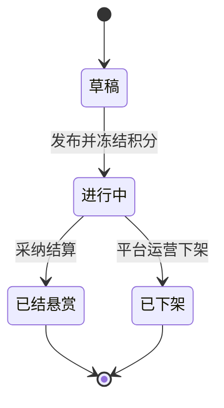
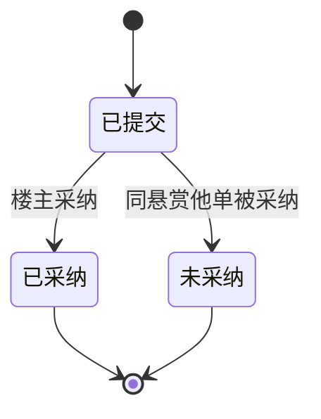
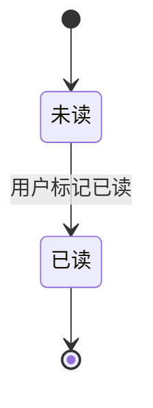

# 悬赏厅完整卷 · 信息架构

> 版本 v1 · 2099-01-02 · 摘要：三张单据的实体、字段、状态机与可见性

## 1 实体清单

| 实体 | 说明 | 关键字段 | 状态集 |
| --- | --- | --- | --- |
| 悬赏单 | 楼主发起的悬赏载体 | 标题、描述、积分、楼主、发布时间、采纳截止时间、下架原因 | 草稿、进行中、已结悬赏、已下架 |
| 回答单 | 回答者提交的回答载体 | 内容、回答者、所属悬赏、提交时间 | 已提交、已采纳、未采纳 |
| 消息记录 | 事件生成的站内通知载体 | 类型、内容、接收角色、关联单据、时间 | 未读、已读 |

## 2 状态机

### 2.1 悬赏单状态机

### 2.2 回答单状态机

### 2.3 消息记录状态机

## 3 字段与消息类型可见性

| 字段或类型 | 楼主 | 回答者 | 平台运营 | 说明 |
| --- | --- | --- | --- | --- |
| 悬赏标题、积分、状态 | 可见 | 可见 | 可见 | 列表卡片与详情头部展示 |
| 下架原因 | 可见 | 可见 | 可见 | 已下架悬赏详情展示，来源于治理留痕 |
| 回答内容 | 可见 | 可见 | 可见 | 详情页按提交时间正序展示 |
| 新回答消息 | 接收 | 不接收 | 不接收 | 归属楼主 |
| 采纳结果消息 | 接收 | 不接收 | 不接收 | 归属楼主 |
| 积分到账消息 | 不接收 | 接收 | 不接收 | 归属回答者 |
| 下架结果消息 | 接收 | 不接收 | 不接收 | 归属楼主 |
