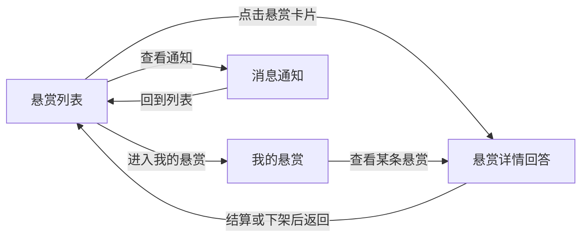

# 悬赏厅完整卷 · 应用架构

> 版本 v1 · 2099-01-02 · 摘要：四个页面的职责、可见角色与流转关系

## 1 页面清单

| 页面 id | 标题 | 可见角色 | 主要动作 | 挂接需求 |
| --- | --- | --- | --- | --- |
| bounty-list | 悬赏列表 | 楼主、回答者、平台运营 | 浏览悬赏、发布悬赏、进入详情、进入我的悬赏、查看通知、下架违规悬赏 | FR-01、FR-05、NFR-01 |
| bounty-detail | 悬赏详情回答 | 楼主、回答者 | 查看详情、提交回答、采纳结算 | FR-02、FR-03 |
| my-bounty | 我的悬赏 | 楼主 | 按状态查看本人悬赏、进入详情 | FR-01、NFR-02 |
| notify | 消息通知 | 楼主、回答者 | 查看消息、单条标记已读、全部标记已读 | FR-04、NFR-02 |

## 2 页面流转

流转以悬赏列表为中心：列表可进详情、我的悬赏与通知；我的悬赏可再看具体详情；其余页面回到列表。发布悬赏在列表页内以表单展开完成，下架动作在列表卡片上就地展开原因面板完成。

## 3 页面状态与交互要点

- 悬赏列表：卡片按发布时间倒序，状态标签区分进行中、已结悬赏、已下架；楼主视角有发布入口，平台运营视角对进行中悬赏有治理入口，回答者视角两者皆无；
- 悬赏详情回答：回答区按提交时间正序；进行中的悬赏对回答者展示回答框、对楼主展示采纳按钮；已结悬赏与已下架只读，已下架额外展示下架原因；
- 我的悬赏：仅楼主可进，按全部、进行中、已结悬赏、已下架过滤；其他角色进入得到无权限提示页；
- 消息通知：仅楼主与回答者可进，四类消息按时间倒序，未读加粗并计入顶栏角标；平台运营进入得到无权限提示页；
- 服务器异常、重复提交等全局界面口径见 PRD 总览 §3。
