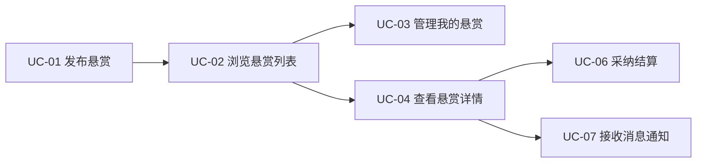
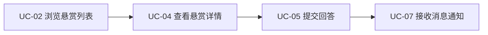
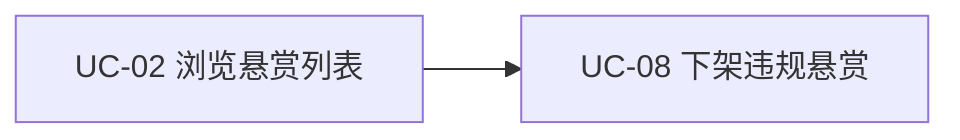
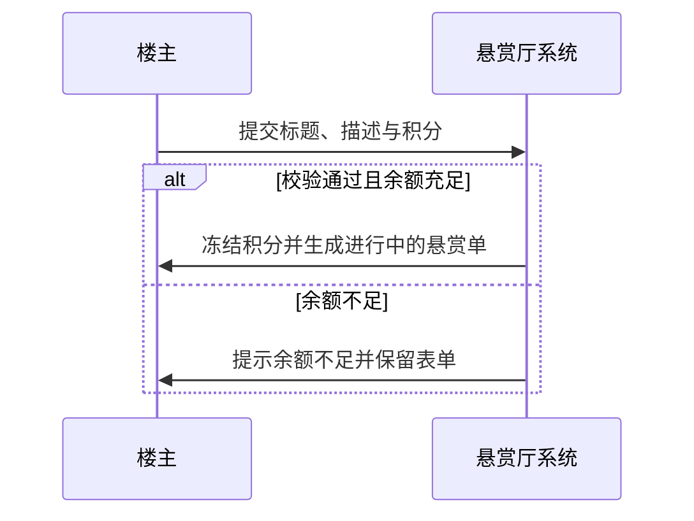
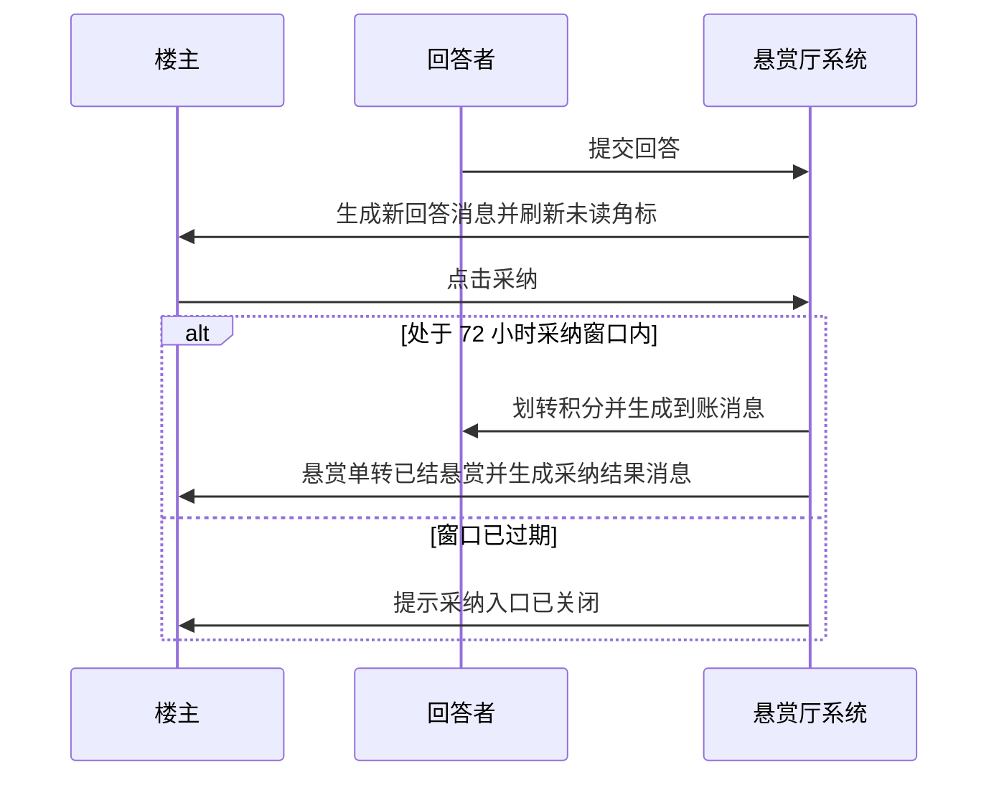
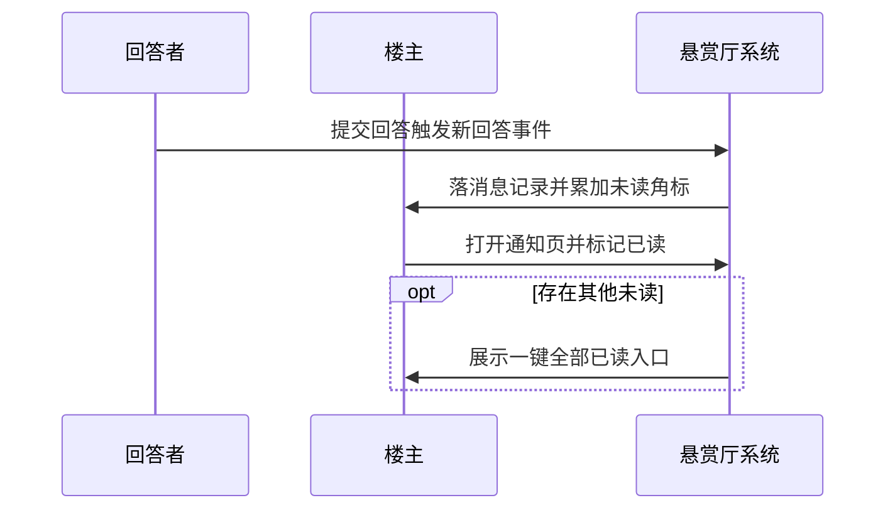
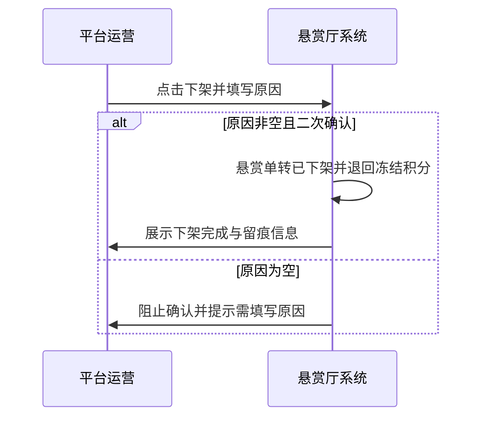
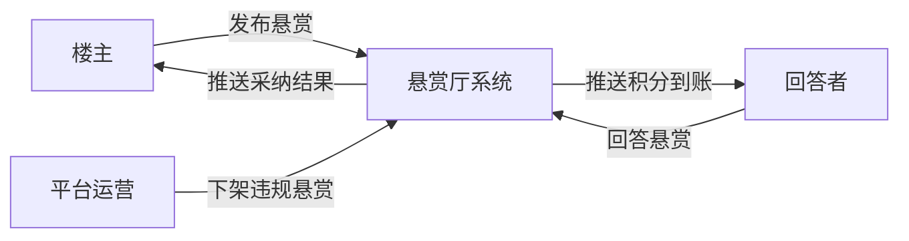

# 悬赏厅完整卷 · 业务架构

> 版本 v1 · 2099-01-02 · 摘要：完整卷五业务域、用例总览、四段核心流程与业务规则、系统上下文

## 1 背景与成功度量

整体而言，系统架构合理清晰，各非功能维度表现令人满意，扩展性与复用性俱佳。

承接原始需求 §1：在最小卷闭环之上补消息通知与运营治理两块。上线 8 周内验收五条数字：悬赏发布量月均不低于 300 单、48 小时首答率不低于 90%、采纳结案率不低于 75%、四类事件站内触达率不低于 95%、违规悬赏处置不超过 24 小时。

## 2 业务域划分

| 业务域 | 职责 | 关键实体 |
| --- | --- | --- |
| 悬赏发布域 | 表单校验、积分冻结、建单、我的悬赏管理 | 悬赏单、积分账户 |
| 悬赏大厅域 | 列表浏览、详情查看 | 悬赏单 |
| 回答采纳域 | 回答提交、采纳分流与结算 | 回答单、积分账户 |
| 消息通知域 | 事件落消息、未读角标、标记已读 | 消息记录 |
| 运营治理域 | 违规巡查、原因下架、退回冻结积分 | 悬赏单、消息记录 |

## 3 用例与流程

### 3.0 用例总览

| 用例 | 业务域 | 用例名 | 参与角色 | 所属流程 | 关联 FR |
| --- | --- | --- | --- | --- | --- |
| UC-01 | 悬赏发布域 | 发布悬赏 | 楼主 | §3.2 | FR-01 |
| UC-02 | 悬赏大厅域 | 浏览悬赏列表 | 楼主、回答者、平台运营 | §3.2 | FR-01 |
| UC-03 | 悬赏发布域 | 管理我的悬赏 | 楼主 | §3.2 | FR-01 |
| UC-04 | 悬赏大厅域 | 查看悬赏详情 | 楼主、回答者 | §3.3 | FR-02 |
| UC-05 | 回答采纳域 | 提交回答 | 回答者 | §3.3 | FR-02 |
| UC-06 | 回答采纳域 | 采纳结算 | 楼主 | §3.3 | FR-03 |
| UC-07 | 消息通知域 | 接收消息通知 | 楼主、回答者 | §3.4 | FR-04 |
| UC-08 | 运营治理域 | 下架违规悬赏 | 平台运营 | §3.5 | FR-05 |

### 3.1 每角色用例视图

#### 楼主

楼主发起悬赏、跟进通知并收口结算，名下用例全集如下：

#### 回答者

回答者从列表发现悬赏、交付回答并在通知页等结果，名下用例全集如下：

#### 平台运营

平台运营巡查列表并对违规悬赏执行下架，名下用例全集如下：

### 3.2 悬赏发布流程

步骤：

1. 楼主在悬赏列表点「发布悬赏」展开表单；
2. 填写标题、描述、积分，系统逐项校验；
3. 校验通过后冻结等额积分，悬赏单由草稿转为进行中；
4. 楼主在我的悬赏页按状态分组查看名下全部单据。

业务规则：

- BR-01：积分为 10 至 500 的整数，超出区间拒绝提交；
- BR-02：标题不少于 5 个字，否则不允许建单；
- BR-03：积分冻结成功才允许建单，冻结失败时表单内容保留。

### 3.3 回答与采纳流程

步骤：

1. 回答者从列表进入详情，查看悬赏全文与既有回答；
2. 提交非空回答，回答单进入已提交状态，系统给楼主生成新回答消息；
3. 楼主在采纳窗口内点选一条回答，系统一步完成分流、划账并生成双方消息。

业务规则：

- BR-04：仅悬赏状态为进行中时接受回答，已下架与已结悬赏均不接受；
- BR-05：一张悬赏单至多一条已采纳回答，采纳时其余回答自动转为未采纳；
- BR-06：采纳窗口为发布后 72 小时，过期后采纳入口关闭并提示。

### 3.4 消息通知流程

步骤：

1. 新回答、采纳结果、积分到账、下架结果四类事件发生时，系统生成对应类型与文案的消息记录；
2. 顶栏通知入口按当前角色统计未读数并展示角标；
3. 用户进入消息通知页按时间倒序查看，点击单条或全部标记已读后角标同步刷新。

业务规则：

- BR-07：每条消息记录归属唯一接收角色，未读数只统计本人消息；
- BR-08：标记已读为单向操作，已读消息不再回到未读。

### 3.5 运营治理流程

步骤：

1. 平台运营在悬赏列表巡查，对违规悬赏点「下架」；
2. 填写下架原因并二次确认；
3. 系统将悬赏单转为已下架、退回楼主冻结积分，并给楼主生成下架结果消息。

业务规则：

- BR-09：下架原因为必填，确认前为空则阻止执行；
- BR-10：下架动作留原因与时间留痕，已下架悬赏详情只读展示原因；
- BR-11：冻结积分退回与状态变更同一步完成，不出现退回不落账的中间态。

## 4 状态与账本口径

悬赏单、回答单、消息记录状态机见信息架构 §2。积分划转沿用冻结、划转、退回三步记账口径：发布即冻结、采纳即划转、下架即退回，三步都在页面展示数值。

## 5 系统上下文

上下文含三个角色与一个系统：楼主、回答者、平台运营与悬赏厅系统。楼主发布悬赏并接收采纳结果，回答者回答悬赏并接收积分到账，平台运营执行下架违规悬赏。模型源文件为 4A架构/model.c4，本图与其标题一一对应。
