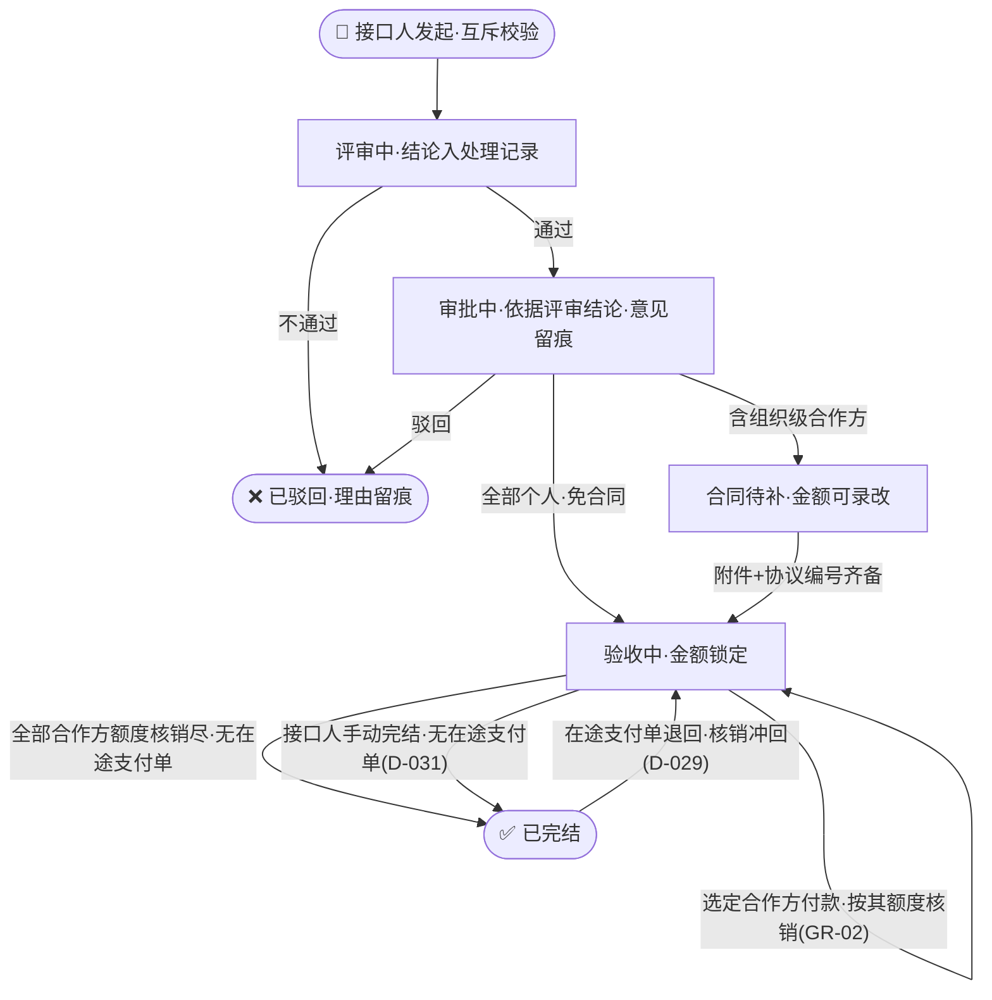
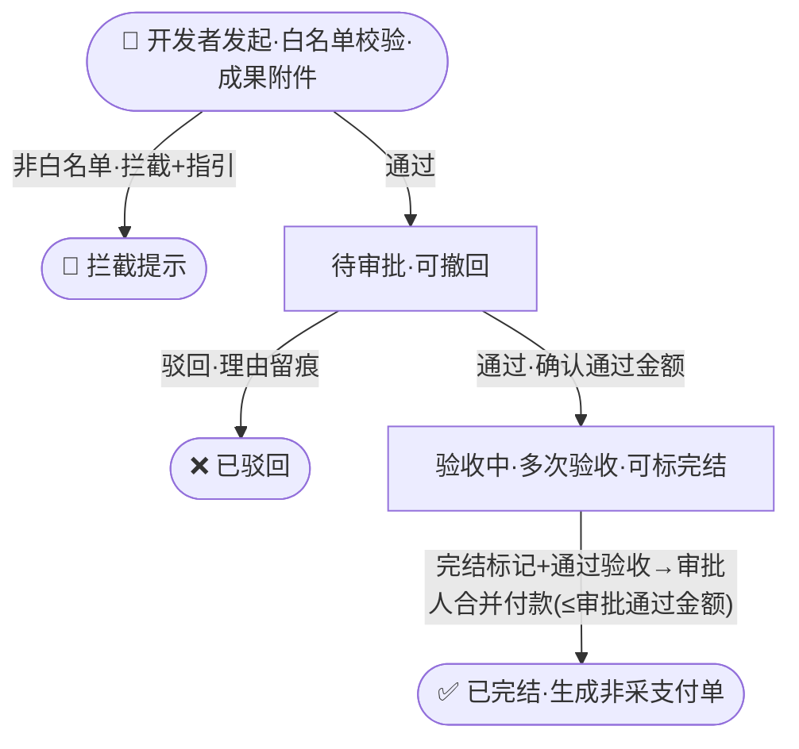
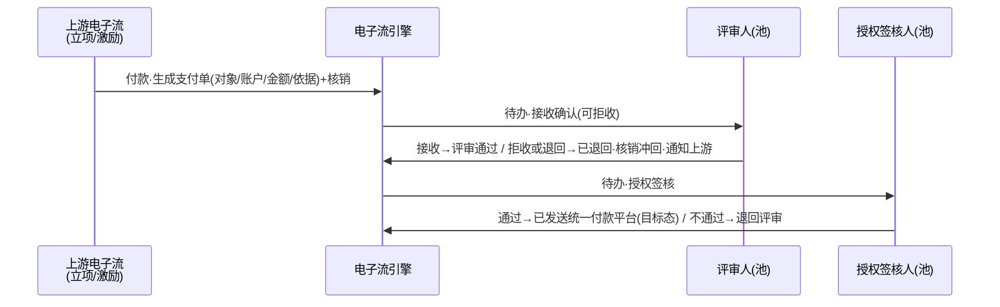
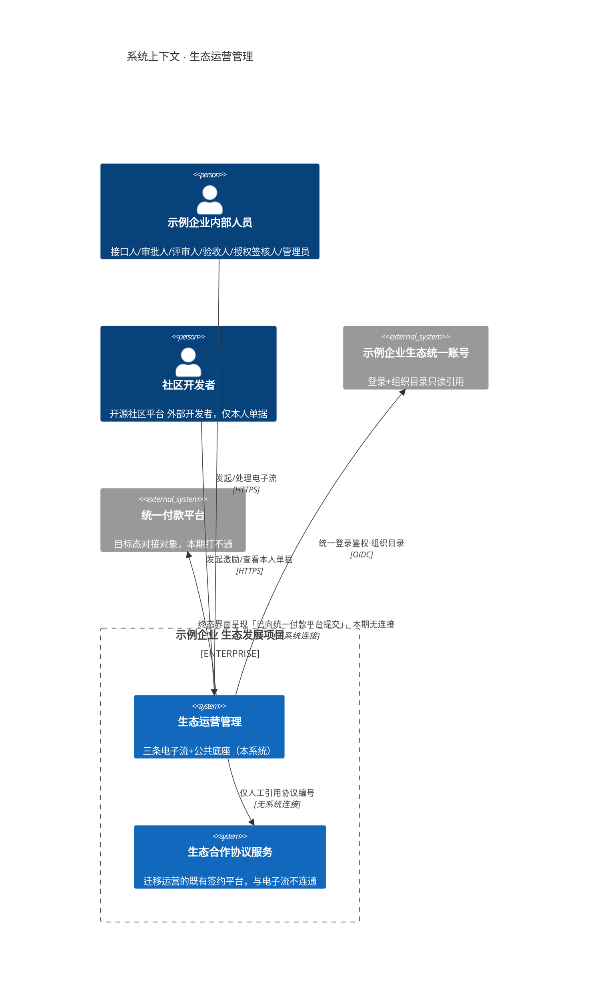

# 业务架构 · 生态运营管理

- 版本 v4 · 2026-10-18 · 门1 R4 用户裁决吸收：GR-04 支付单同单评审≠授权签核、D-032 管理员当前环节改派兜底、D-031 接口人手动完结、D-009 经用户确认

## 1 用户与角色 [FR-01] [FR-03] [NFR-01] [NFR-02] [GR-03]

系统操作者分两类七角色，全部经示例企业生态统一账号登录（不自建账号；用户首次登录自动建档，部门与人员候选来自统一账号组织目录只读引用）。**内部人员**：业务接口人代合作方发起并推动合作立项全流程，可为在途单更换未开始环节的处理人；审批人、评审人、验收人处理分派到本人的环节（合作立项三人在发起时由接口人从挂靠部门指定，社区激励与支付流人员由管理员配置的**人员池**按单绑定）；授权签核人对支付单行使授权签核；系统管理员维护权限、人员池与白名单。**外部用户**：开源社区平台 社区开发者本人发起激励申请，只能看到和处理本人的申请单及其派生支付单的进度（只读）；其可见目录为「我的工作空间+社区开发者激励+非采对外支付（仅本人派生单）」。合作方与付款对象（4 大类）本期是被记录对象，不是系统操作者。角色×权限字段级矩阵见 detail.json `roles`。

权限规则：**互斥原则（GR-01）**——同一张单据上评审人≠审批人、审批人≠验收人，指定/配置时当场校验；**权责分离（GR-03/GR-04）**——支付单的评审/授权签核人不得为该单付款发起人、**同一支付单上评审人≠授权签核人**（单内绑定校验），白名单变更审批人独立配置且不得为提交人。

## 2 业务域与核心流程

### 2.1 合作立项流 [FR-07] [FR-08] [FR-09] [FR-10] [FR-11] [GR-01] [GR-02] [GR-03]

- 触发：业务接口人从「对外支付项目>合作项目」发起，**代**外部合作方填单（合作方不自行发起）。
- 步骤：
  1. 接口人填写项目信息与多个合作方（项目:合作方 = 1:N）：每个合作方录入**对象标识**（组织=统一社会信用代码、个人=统一账号ID，作付款白名单校验键；由接口人向合作方收集并对其真实性负责，随发起留痕）与收款账户（进入验收中即锁定，变更须接口人确认并写入处理记录）；组织级合作方线下/老平台签合同，合同规定金额在「合同待补」态录入合同实体（唯一事实源）；个人合作方发起时录入**付款额度**（免合同不免额度）→ 从挂靠部门指定评审/审批/验收人，系统校验互斥（GR-01）→ 提交进入「评审中」（各动作写入处理记录留痕）；
  2. 评审人评审并将**评审结论**写入处理记录（单据留痕，审批与审计可查）→ 通过进入「审批中」；
  3. 审批人依据处理记录中的评审结论审批，**审批意见（驳回必附理由）写入处理记录** → 通过且含组织级合作方进入「合同待补」，全部个人直接进入「验收中」；
  4. 接口人在「合同待补」态提交合同信息（附件+协议编号+金额；金额此阶段可录改，修改留痕，进入验收中即锁定）→ 齐备进入「验收中」；
  5. 验收人多次验收，每次验收记录含**结论（通过/不通过）**，可勾选「验收完结」；不通过仅留痕并通知接口人，再次验收即整改通道；
  6. 存在≥1条通过验收后，接口人**选定合作方**发起付款：系统按该合作方对象标识校验白名单（NFR-03），页面呈现其额度/已核销/剩余，本次金额校验累计核销≤该合作方额度（组织=合同规定金额，个人=付款额度）→ 生成一张非采支付单+核销记录（同事务，含资格校验依据快照），可多次付款（幂等防重）；
  7. 全部合作方额度核销尽**且无在途支付单** → 项目「已完结」；接口人也可在「验收中」态**手动完结**项目（前置=无在途支付单，剩余额度作废并留痕，D-031）。
- 业务规则：R1 项目:合作方=1:N；R2 组织及以上须签合同、个人免合同；R3 GR-01 互斥与 GR-03 权责分离；R4 额度按合作方管控、逐次核销（GR-02），合同规定金额唯一事实源在合同实体；R5 合同仅附件+协议编号引用（协议编号本期为自由文本，不校验格式与存在性）；R6 额度/累计核销为付款事务内实时聚合，不落地冗余字段；R7 金额统一两位小数、以「分」为整数比较（D-030）。
- 异常分支：评审不通过或审批驳回 → 「已驳回」终态，理由在处理记录中可查，接口人重新发起新单；接口人在评审中/审批中可撤回 → 回「草稿」可编辑重提，重提时可更换人员并重跑互斥校验；已完结后若在途支付单被退回（核销冲回、额度释放）→ 项目回「验收中」，可重新发起付款（D-029）。

### 2.2 社区开发者激励流 [FR-12] [FR-13] [FR-14] [GR-01] [GR-02] [GR-03]

- 触发：开源社区平台 社区开发者本人登录发起（本期唯一渠道）；表单含任务/成果描述、**成果附件**与**收款账户**（本人录入，进入验收中即锁定），提交时系统以会话身份匹配白名单（非白名单当场拦截，提示原因与进入白名单的指引）。
- 步骤：
  1. 提交 →「待审批」（开发者在待审批态可撤回）；
  2. 池绑定的审批人审批（1:1）：核对收款账户、确认/下调「审批通过金额」（默认=申报金额，不可上调，调整留痕）→ 通过进入「验收中」，驳回（理由留痕并通知开发者）→「已驳回」；
  3. 池绑定的验收人（≠审批人，GR-01）多次验收，可勾选「验收完结」；
  4. 出现验收完结标记且≥1条通过验收后，审批人**合并发起一次付款**（额度=审批通过金额，页面呈现额度/已核销/剩余）→ 生成非采支付单 → 激励单「已完结」；开发者可在本人详情中只读跟踪派生支付单进度；该支付单被退回时核销冲回、激励单保持「已完结」，审批人可重新发起（新支付单引用原单，D-029/D-010）。
- 业务规则：R1 仅白名单内可发起（会话身份硬校验）；R2 项目:开发者=1:1；R3 审批人/验收人池配置且互斥（GR-01）、付款发起人不得任本单支付评审/授权签核（GR-03）；R4 合并一次付款、不超审批通过金额（GR-02）。
- 异常分支：驳回/撤回见步骤；支付单被退回时核销冲回释放额度，通知审批人与开发者，可重新合并发起。

### 2.3 非采对外支付流 [FR-15] [FR-16] [NFR-04] [GR-03]

- 触发：不独立发起。合作立项每次付款、激励合并付款各生成一张支付单，携带上游单据、付款对象（4 类）、收款账户、金额与**付款依据**（验收记录/协议编号/审批通过金额）。
- 人员解析：支付评审人与授权签核人由配置池按单解析，**均不得为该单付款发起人**（GR-03），且**同一支付单上评审人≠授权签核人**（GR-04，单内绑定校验；两池成员可重叠）。
- 步骤（固定四步，授权签核必备）：
  1. 生成 →「待接收」；评审人接收确认，可**拒收**（上游信息错误，**必附原因**）→「已退回」；
  2. 评审 → 通过进入「待授权签核」，不通过 →「已退回」（**必附原因**，对齐立项驳回口径）；
  3. 授权签核（≠本单评审人，GR-04）→ 不通过退回评审重处理（**必附原因**）；通过流转至终点；
  4. 终点界面按目标态呈现**「已向统一付款平台提交付款申请」**——本期与统一付款平台无系统级对接，无任何对外调用。
- 业务规则：R1 流程固定不可增删节点；R2 授权签核必备；R3 本期统一付款平台零对接（NFR-04）；R4 上游发起人（接口人/审批人/开发者本人）对派生支付单只读可见，用于跟踪。
- 异常分支：拒收/评审退回 →「已退回」终态，**对应核销记录同事务冲回释放额度**（D-010），通知上游发起人（激励流同步开发者），上游可重新发起付款（新支付单引用原支付单id保持审计链）；授权签核不通过 → 退回评审（单据在途，核销不冲回）。

### 2.4 白名单管理流 [FR-04] [NFR-03] [GR-03]

- 触发：系统管理员从「系统管理>白名单管理」进入。
- 步骤：Excel 批量导入（**整单校验**：失败行列出原因，全部通过方可提交）或手工变更 → 生成白名单变更单 → 提交审批（审批人由配置的名单审批人解析，**≠提交人**）→ 通过后按审批时间**串行写回**条目（并发变更后单覆盖前单并留痕）。
- 业务规则：R1 白名单为支付资格硬约束（NFR-03 对激励与支付双路径生效）：**开发者类**（激励发起、个人合作方付款）以会话身份匹配（键=统一账号用户ID）；**组织类**（立项付款的合作方）以单据登记的对象标识匹配（键=统一社会信用代码，发起时必录）；4 类付款对象映射：开发者/高校人才/开源社区（个人）→开发者类，生态伙伴（企业/组织）→组织类；R2 变更必须走审批、未审批不生效；R3 提交人≠审批人（GR-03）；R4 非白名单拦截提示附进入白名单的指引（联系管理员/接口人）。
- 异常分支：驳回 → 变更单「已驳回」，理由写入处理记录，名单保持原状。

### 2.5 权限管理流 [FR-03] [GR-03]

- 触发：系统管理员从「系统管理>权限管理」进入。
- 步骤：维护用户角色（一人可配多角色，本期生效范围固定全平台）与**人员池**（激励审批/激励验收/支付评审/支付授权签核/白名单审批五类池，保存时校验池非空、激励审批池与验收池无交集；支付单绑定校验 GR-04 同单评审≠授权签核）→ 保存生效，配置变更写入处理记录留痕 → 权限决定目录/功能/动作可见性。管理员另负**环节处理人改派兜底**：处理人离职/长期不可用时对任意**在途环节**强制改派（终态单据不可改派；重跑互斥与权责分离校验 GR-01/03/04、通知新旧处理人、留痕，D-032）。流程定义本期为开发预置，管理员只读查看（D-026）。

### 2.6 底座公共服务流 [FR-01] [FR-02] [FR-05] [FR-06] [NFR-06] [D-012]

电子流通用底座提供**表单、流程、待办**三个通用引擎，三条流全部基于底座定义运转，后续新流凭配置接入。所有用户拥有**我的工作空间**（我的待办/我的申请/我的已办，列表条目含单据类型、当前环节、到达时间）。**通知接收矩阵（D-012）**：待办产生→环节处理人；状态变更（驳回/退回/完结/生效）→上游发起人（激励支付退回同步开发者本人）；处理结果→发起人+相关处理人；触发粒度为单据状态跃迁——子记录（验收/核销）追加不触发，但验收**不通过**属结论性事件、按「处理结果」触发通知接口人（D-014 口径优先）。**附件管理**：各环节挂接合同附件、成果证明、验收材料。

## 3 业务实体总览 [FR-04] [FR-07] [FR-08] [FR-09] [FR-10] [FR-11] [FR-12] [FR-13] [FR-14] [FR-15] [FR-16] [GR-02] [GR-03]

- **合作立项单**：接口人创建，评审→审批→合同→验收→付款推进；额度与累计核销为实时聚合不落字段（防冗余失真）。
- **合作方关联/合同**：1:N 合作方，均录对象标识（白名单校验键）与收款账户；组织级挂合同（合同实体为合同规定金额唯一事实源，附件+协议编号），个人级录入付款额度；金额/额度进入验收中即锁定。
- **处理记录**：全单据通用留痕实体（环节含 发起/评审/审批/验收/授权签核/白名单审批/接收拒收/撤回/合同信息提交与金额录改/换人（含管理员改派 D-032）/付款发起/项目完结与额度作废（D-031）/配置变更；处理人/动作/结论或意见/时间，只增不改）——承载评审结论、审批意见与驳回理由、授权签核意见、退回原因、金额录改前后值、白名单审批、配置变更留痕。
- **验收记录**：结论（通过/不通过）+验收完结标志；**核销记录**：按合作方（合同）逐次冲减，含原支付单id 重发链，可冲回。
- **社区激励单**：开发者本人创建，1:1，含成果附件与审批通过金额。
- **非采支付单**：仅上游生成，携带收款账户与付款依据，固定四步；**人员池配置**：五类池支撑激励与支付流取人。
- **白名单条目/变更单、电子流定义、消息通知、附件、用户角色配置**：见 detail.json。

## 4 系统上下文（C4 Context）[NFR-01] [NFR-04] [NFR-05]

系统边界外仅三类交互：统一账号做登录鉴权与组织目录引用；生态合作协议服务迁移至自有服务器隔离区独立运营但**不连通**，电子流只在单据内保留协议编号字符串；统一付款平台本期无任何调用，支付单在系统内走完即呈现目标态。

## 5 风险与开放问题

| 风险/开放点 | 影响 | 缓解或决策建议 |
|---|---|---|
| 统一付款平台打不通，界面按目标态呈现 | 验收方可能追问「钱真的发出去了吗」 | 验收时明确口径：终态文案即本期承诺上限；后续统一付款平台评审通过后补对接 |
| 项目提前终止/部分付款后不再付款 | 立项单可能长期停在「验收中」 | 已裁决（D-031）：接口人可手动完结（无在途支付单），剩余额度作废留痕 |
| 个人合作方付款额度的业务口径（D-009） | 免合同额度由接口人自定，可能偏松 | 付款页三项对照展示；额度录入后锁定（D-019）；收口呈报确认 |
| 人员池集中配置的可用性 | 池小或交集导致绑定失败 | 配置时校验池非空/无交集（§2.5）；绑定时拦截并提示管理员 |
| 开源社区平台 为唯一外部渠道 | 扩渠道需改发起校验 | 渠道作为来源标记，白名单匹配键已按账号体系设计（D-015），扩渠道仅增枚举 |
| 协议服务迁移并行运营 | 老数据迁移完整性本期无法系统验证 | 迁移属部署事项，与电子流零耦合（NFR-05），不阻塞本设计 |
