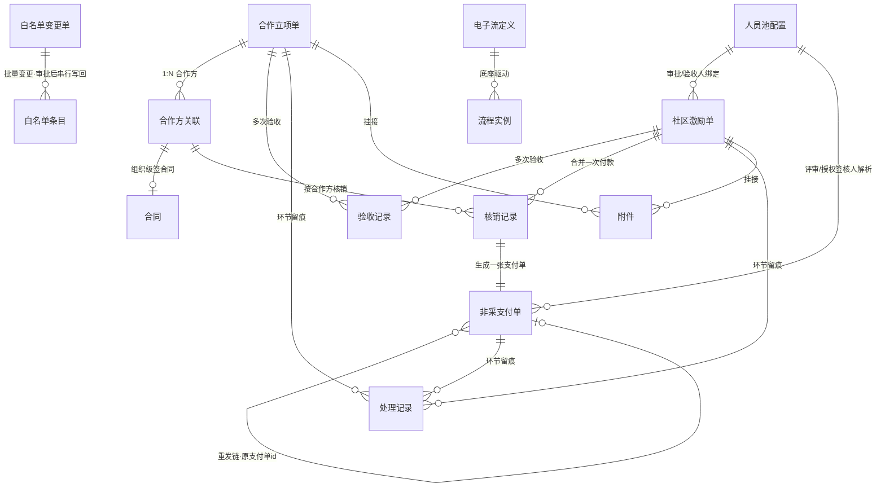
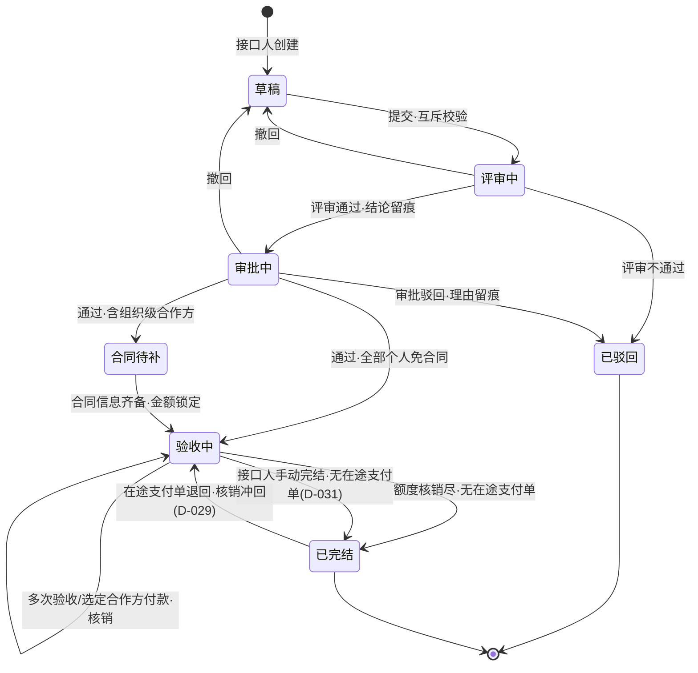
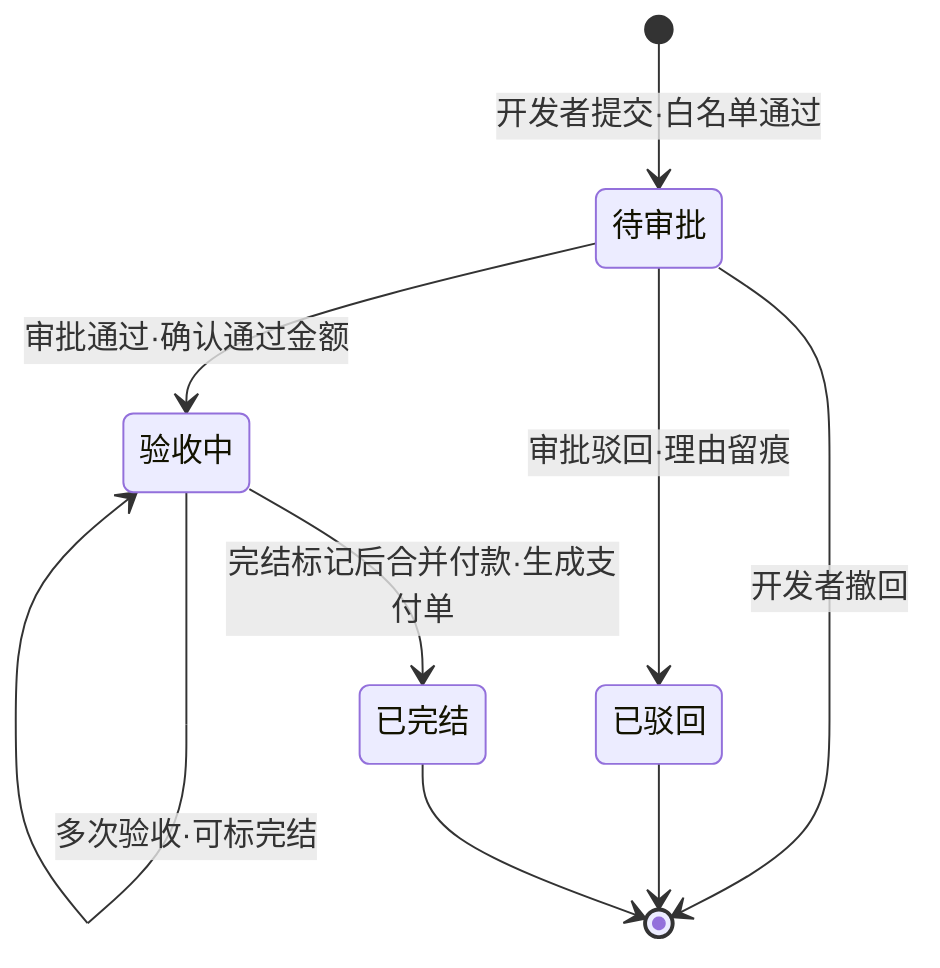
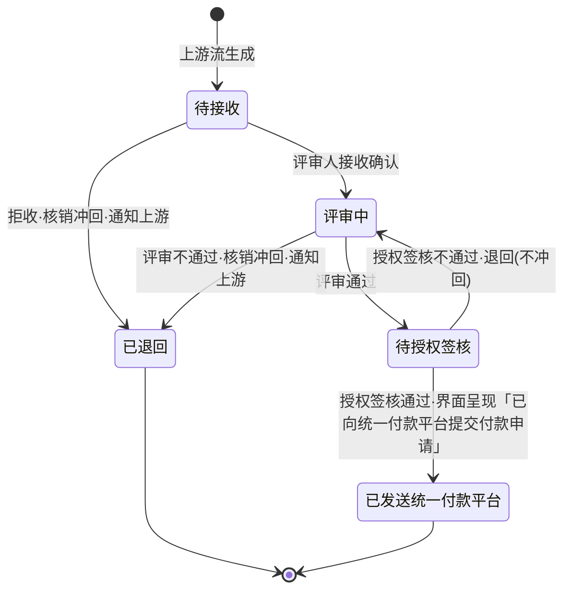

# 信息架构 · 生态运营管理

- 版本 v4 · 2026-10-18 · 门1 R4：立项状态机补手动完结边（D-031）、支付单 GR-04 同单评审≠授权签核口径

## 1 内容与实体模型

全景关系：立项单与激励单是两条上游业务流单据，各自派生非采支付单（立项 1:N、激励 1:1）；**额度按合作方管控**——组织级合作方挂合同（合同规定金额为额度），个人级合作方在合作方关联上直接录入付款额度；核销记录挂合同/合作方逐次冲减；处理记录是全单据通用留痕（评审结论/审批意见/驳回理由/授权签核意见/白名单审批/配置变更）；人员池配置支撑激励与支付流取人。

关键建模说明：

- **额度在合作方维度（GR-02）**：组织级=合同规定金额（唯一事实源在合同实体）、个人级=合作方关联上的付款额度；核销记录逐次冲减并记录核销后余额与资格校验依据快照；立项单上的额度/累计核销是付款事务内实时聚合视图，不落冗余字段。
- **白名单校验键（NFR-03/D-015）**：合作方关联必录对象标识（组织=统一社会信用代码、个人=统一账号ID）；激励发起以会话身份、立项付款以对象标识为键校验；4 类付款对象映射：开发者/高校人才/开源社区（个人）→开发者类，生态伙伴（企业/组织）→组织类。
- **处理记录只增不改**：一切「谁在哪个环节说了什么」的留痕（含驳回理由、退回原因）都进这一实体，审计可重构证据链；消息通知是瞬态载体，不承担留痕职责。
- **重发链**：已退回支付单的核销同事务冲回（states：已生成/已冲回），重新发起的新支付单以原支付单id引用旧单，退回-重发全程可追溯。
- **白名单两层**：条目是资格事实（匹配键=统一账号ID/统一社会信用代码），变更单是变更过程；分离使「导入不直接生效」「提交人≠审批人」成为结构保证。
- **电子流定义**：表单 schema+流程节点+人员解析策略的配置整体（本期开发预置），是 NFR-06 的载体。

## 2 状态模型 [FR-07] [FR-10] [FR-11] [FR-13] [FR-14] [FR-16] [FR-04]

**合作立项单**（撤回分支：评审中/审批中可撤回回草稿，草稿可编辑重提）：

**社区激励单**（终态统一为「已完结」；待审批可撤回）：

**非采支付单**（固定四步；退回即核销冲回）：

**白名单变更单**：待审批 →（通过）已生效（按审批时间串行写回条目）/（驳回）已驳回（理由留痕）。**核销记录**：已生成 ⇄ 已冲回（退回冲回、重发再生成）。

## 3 数据权限与隔离 [NFR-02] [NFR-03] [GR-01] [GR-03]

行级规则（服务端强制，前端隐藏不作为依据）：

- **外部社区开发者**：仅见/操作本人激励单；可只读查看本人激励单派生的支付单进度（兑现「知道钱何时发出」，不破坏隔离——隔离对象是他人单据）；可见目录为 我的工作空间+社区开发者激励+非采对外支付（仅本人派生单可达）。
- **业务接口人**：本人立项单及合同/验收/核销记录全量可见，其派生支付单只读。
- **审批人**：分派到本人的环节单据（含白名单变更单审批）；本人发起合并付款的激励派生支付单只读。
- **评审人/验收人/授权签核人**：仅分派到本人的环节单据；处理后经「我的已办」回看。
- **系统管理员**：全量配置数据（角色/人员池/白名单/流程定义只读）+业务单据只读（仅改派兜底 D-032 所需，在途环节可改派）；不得审批自己提交的白名单变更单（GR-03）。
- **白名单数据**：管理员读写，业务发起/付款事务内只读校验（NFR-03）。
- **互斥与权责分离落点（GR-01/GR-03/GR-04）**：人员指定、池绑定、支付取人（含同单评审≠授权签核）写入时校验，属数据写入规则而非页面规则；管理员改派（D-032）同样重跑校验。

## 4 信息组织与导航 [NFR-07]

界面按三级目录组织，依据「个人任务、业务域、治理域」三类信息性质：

- **一级·我的工作空间**：我的待办/我的申请/我的已办/通知中心。
- **一级·对外支付项目**：二级为 合作项目框架（立项电子流公共信息聚合页，D-001）、合作项目（其下三级：高校外部合作项目（合作共创）、社区开发者激励）、非采对外支付。
- **一级·系统管理**：权限管理、白名单管理（变更单详情挂白名单管理之下）。管理员另可只读浏览三个业务列表页（改派兜底 D-032 入口：列表→详情→在途环节改派）。

全部页面导航路径以 detail.json `pages[].nav` 为准；外部开发者可见目录按 §3 边界裁剪。
