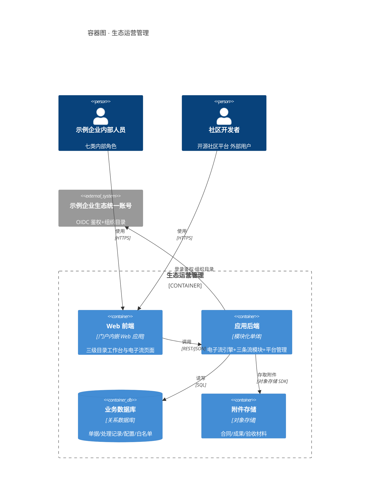
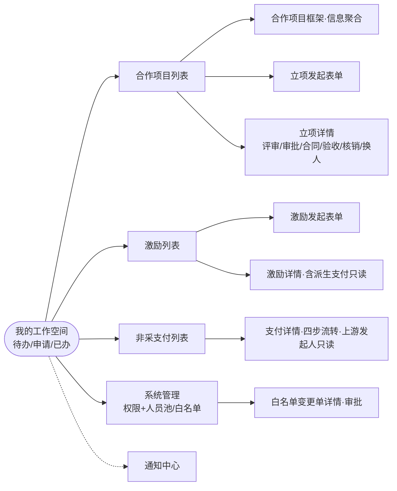
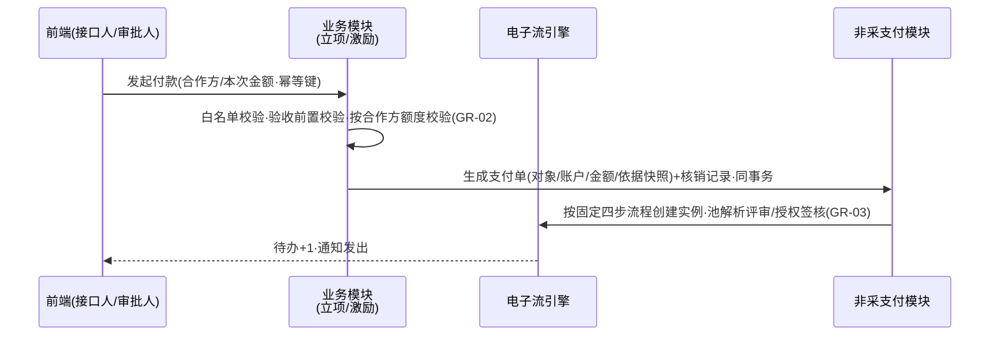

# 应用架构 · 生态运营管理

- 版本 v4 · 2026-10-18 · 门1 R4：人员解析补 GR-04 同单评审≠授权签核、管理员改派兜底（D-032）、手动完结路径（D-031）

## 1 应用与服务划分（C4 Container）

四个容器：**Web 前端**（数智运营平台门户内一级菜单应用）；**应用后端**（模块化单体——电子流引擎、合作立项/社区激励/非采支付三个业务模块、平台管理模块（权限与人员池/白名单/通知/附件），单体是本期交付节奏下的最简划分，模块边界即未来拆分线；业务模块与平台管理的耦合点为付款事务内的白名单只读校验，其失效行为=拦截付款并提示，不降级放行）；**业务数据库**；**附件存储**。外部系统（统一账号/协议服务/统一付款平台）的边界见 业务架构 §4。

## 2 界面与交互 [FR-02] [FR-07] [FR-12] [FR-16] [NFR-07] [NFR-02]

页面共 16 个，全部挂在三级目录下（页面清单、页面×角色可见性、每页动作的字段级明细在 detail.json `pages`）。交互主线：**入口在工作空间，动作在详情页**——所有角色从「我的待办」进入待处理单据（评审人/审批人的立项评审与审批动作也在详情页完成），从「我的申请」跟踪本人发起单据；接口人在立项详情完成合同补齐、验收推进、选定合作方付款与处理人更换；开发者在激励详情撤回/跟踪并只读查看派生支付单进度；支付详情对上游发起人只读开放；白名单变更单详情承载审批动作。

## 3 接口设计

后端按资源域暴露 REST 接口，九组：`auth`（OIDC 回调、会话、组织目录查询）、`tasks`（待办/已办查询与处理动作）、`coop-projects`（创建/提交/撤回/编辑重提/合同信息/评审结论/审批/验收/付款发起/换人）、`incentives`（创建/撤回/审批含通过金额/验收含完结标记/合并付款）、`payments`（接收/拒收/评审/授权签核）、`whitelists`（导入/变更提交/变更审批）、`roles`（角色权限与人员池配置）、`attachments`（上传/下载）、`notifications`（列表/已读）。字段级出入参本期不做全量契约（设计期范围裁剪，低保真粒度），关键字段口径以 detail.json `entities` 为准。关键事务约定：**付款发起接口幂等**（单据id+请求id 作幂等键，重复提交不生成第二张支付单）；核销+支付单生成+（退回时）核销冲回均为同事务。

## 4 流程编排与规则引擎 [FR-01] [FR-07] [FR-08] [FR-13] [GR-01] [GR-02] [GR-03]

电子流引擎统一承载流程定义、节点路由与人员解析，三条流仅是三份配置化定义（本期开发预置，管理员只读查看）：

- **流程定义**：每条流一份定义（节点序列+每节点表单+出口规则）。立项=评审→审批→(合同)→验收→付款；激励=审批→验收→合并付款；支付=接收→评审→授权签核→发送统一付款平台（固定链，不可配置增删）；白名单变更复用引擎的审批节点。
- **人员解析**：①发起时指定（立项三角色，候选范围=挂靠部门组织目录，提交时校验 GR-01）；②系统预配置池（激励审批/验收池、支付评审/授权签核池、白名单审批人池——管理员在权限管理页配置，生成实例时按单绑定；激励池保存时校验审批/验收池无交集）；③固定链（支付流按池解析，评审/授权签核均不得为该单付款发起人（GR-03）且同单评审≠授权签核（GR-04，两池成员可重叠、单内绑定校验））。④管理员改派兜底（D-032）：在途环节处理人不可用时强制改派（终态单据不可改派），重跑互斥与权责分离校验（GR-01/03/04）、通知新旧处理人并留痕。
- **硬校验落点**：白名单资格校验在事务内（NFR-03）——激励提交按会话身份、立项付款按所选合作方的对象标识（组织=统一社会信用代码/个人=统一账号ID，发起必录），命中依据快照入核销记录；付款发起前置=≥1条「通过」验收记录（立项/激励同），额度校验按所选合作方、核销记录+支付单生成同事务（GR-02）；激励合并付款前置=存在「验收完结」标记（D-013）；合同规定金额唯一事实源在合同实体、仅「合同待补」态可录改（修改留痕），个人付款额度发起时录入、修改窗口同止于验收中（D-019）；互斥/权责分离校验在人员写入时（GR-01/GR-03）。
- **退回事务语义（D-010）**：支付单拒收/评审退回→「已退回」与对应核销记录「已冲回」同事务，额度即时释放，通知上游发起人（激励流同步开发者）；重发付款走全新幂等事务，新支付单引用原支付单id。
- **超时与催办**：本期需求未提出，不设计；若门内走查判为界内缺口走回流协议增补。
- **冲正口径**：驳回即终态、可重新发起新单；支付单层面无反向单据，仅核销记录状态冲回（D-010）。

## 5 核心不变量与边界规则

1. **状态唯一修改权**：单据状态仅由电子流引擎按流程定义推进；业务模块只能发起动作，不得直改状态字段。
2. **互斥是写入规则**（GR-01/03/04）：人员指定/池绑定在任何入口都必须校验同单评审≠审批、审批≠验收、支付单评审/授权签核≠付款发起人（GR-03）、支付单评审≠授权签核（GR-04，单内绑定校验）。
3. **核销守恒按合作方**（GR-02）：单合作方累计核销 ≤ 其额度（组织=合同规定金额、个人=付款额度），校验与支付单生成同事务，失败整体回滚；仅计「已生成」态核销，已冲回不计入。
4. **退回必冲回**（D-010）：支付单进入「已退回」的事务内必须同步核销记录「已冲回」，二者不得分离——额度占用与支付单在途状态强一致。
5. **付款幂等**：同一单据的付款发起以幂等键（单据id+请求id，前端生成 UUID 随请求携带）去重，并发重复提交至多生成一张支付单。
6. **完结判定含在途约束**（D-029/D-031）：立项「已完结」=额度核销尽+无在途支付单（自动）或接口人手动完结（前置同，剩余额度作废留痕）；完结事务提交时复验在途集合；在途支付单退回触发 已完结→验收中 回退（并发兜底边）；激励单保持终态、重发走支付侧并引用原支付单id。
7. **金额口径**（D-030）：全部金额字段统一两位小数、以「分」为整数单位存储与比较；额度核销尽的完结判等为整数精确等值，禁止浮点判等。
8. **留痕强制**：处理记录只增不改；发起/评审/审批/验收/授权签核/白名单审批/接收拒收/撤回/合同信息提交与金额录改/换人（含管理员改派）/付款发起/项目完结与额度作废/配置变更全部环节强制写入（金额录改记录改前值/改后值）。
9. **支付单不可逆派生**：支付单生成后，上游单据的付款对象与已派生金额不可变更；改动只能通过驳回后重新走流程。
10. **外部数据隔离在服务端**（NFR-02）：外部用户请求一律按会话身份过滤；白名单匹配采信会话身份（激励）与单据登记对象标识（立项付款），不采信表单自填标识（D-015）。
11. **白名单生效唯一路径**（FR-04/GR-03）：条目变更仅经「变更单审批通过」写入；导入接口只创建变更单；提交人≠审批人。
12. **协议服务零耦合**（NFR-05）：与生态合作协议服务无共享库、无服务调用，关联仅限单据内协议编号字符串（本期自由文本）；违反即边界事故。
