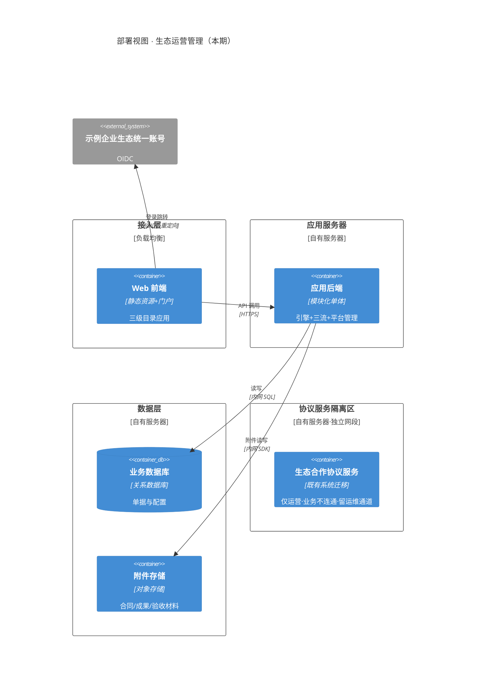

# 技术架构 · 生态运营管理

- 版本 v2 · 2026-10-18 · 门1 R1 修订：补环境划分/部署参数骨架/运行保障节、OIDC 接入清单标注、外部集成边界表去复述（收口到业务架构 §4）

## 1 技术栈与理由 [NFR-01] [NFR-05] [NFR-06]

| 层 | 选型 | 理由 |
|---|---|---|
| 前端 | 数智运营平台门户内嵌 Web 应用（组件化页面） | NFR-07：作为门户一级菜单挂载，不独立建站 |
| 后端 | 模块化单体应用（电子流引擎/三流模块/平台管理模块） | NFR-06：模块边界即新流接入点，单体满足 11·20 交付节奏，避免过早拆分 |
| 数据库 | 关系数据库（事务型） | 核销守恒、退回冲回、白名单生效、状态推进均需强事务（GR-02、应用架构 §5） |
| 附件 | 对象存储 | 合同/成果/验收材料为文件型附件，与业务库分离（FR-06） |
| 身份 | 示例企业生态统一账号 OIDC 接入 | NFR-01：不自建，仅接入；组织目录只读引用（D-020） |
| 通知 | 站内通知中心（应用内表+角标） | D-004/D-012：平台内通知，无外部渠道依赖 |
| 集成 | 与协议服务/统一付款平台零连接 | NFR-04/05：本期无系统级对接 |

## 2 部署架构（C4 Deployment）

自有服务器部署，含迁移来的协议服务隔离区（NFR-05：独立网段、不与主应用互通，但保留管理员/运维/备份通道）；环境划分：开发/测试/生产三套，配置项（OIDC 五端点与回调、DB 连接、桶名、域名证书）以配置清单形式在部署前与基础设施组确认：

部署参数骨架（节点数量/CPU/内存/磁盘/OS/软件版本/端口/域名证书——**部署前与基础设施组确认后填实**）：接入层 LB×1、应用服务器≥2（无状态可横扩）、数据库主备×2、对象存储按附件配额规划；隔离区独立网段 ACL 白名单（源=运维网段/目标=协议服务端口）。

## 3 质量场景（非功能需求满足方式）[NFR-01] [NFR-02] [NFR-03] [NFR-04] [NFR-05] [NFR-06] [NFR-07]

每条 NFR 对应一个可验证场景（刺激/环境/响应/度量）：

| NFR | 刺激 | 环境 | 响应 | 度量 |
|---|---|---|---|---|
| NFR-01 统一账号 | 内/外部用户打开系统 | 正常运行 | 跳转统一账号认证，回跳进入工作台；系统内无本地口令 | 登录链路无自建密码存储（可代码核查）；回跳首屏 ≤3s |
| NFR-02 数据隔离 | 外部开发者以他人单据 ID 直接发请求 | 运行期 | 服务端按会话身份过滤，拒绝越权 | 越权请求 100% 返回拒绝；列表仅含本人单据 |
| NFR-03 白名单硬约束 | 非白名单开发者提交激励发起 | 提交事务内 | 当场拦截并提示原因与指引，不生成单据 | 拦截率 100%（校验在事务内，会话身份匹配） |
| NFR-04 统一付款平台目标态 | 支付单完成授权签核 | 运行期 | 界面呈现「已向统一付款平台提交付款申请」 | 对统一付款平台的网络调用数 = 0 |
| NFR-05 协议服务隔离 | 电子流全生命周期运行 | 运行期 | 单据仅保存协议编号字符串 | 与协议服务的网络调用数 = 0、无共享库 |
| NFR-06 底座可扩展 | 新增一条电子流定义 | 配置态 | 复用引擎，仅新增流程/表单配置 | 新流接入不修改引擎代码（本期由开发预置配置，D-026） |
| NFR-07 三级目录 | 用户浏览全部页面 | 运行期 | 页面均落在三级目录内 | detail.json 全部 pages[].nav 属三级目录（机械可查） |

## 4 外部集成边界 [NFR-04] [NFR-05]

各外部系统的目标态/本期实态事实源在 业务架构 §4（系统上下文），此处只记演进路径：

| 外部系统 | 演进路径（本期→未来） |
|---|---|
| 统一付款平台 | 统一付款平台部门评审通过后，在「已发送统一付款平台」状态点增加对接适配器；预留字段位（统一付款平台受理号/提交时间，本期空置）；界面文案不变 |
| 生态合作协议服务 | 若未来打通，从协议编号自由文本演进为平台校验与服务引用，单据模型无需重构（D-024） |
| 示例企业生态统一账号 | OIDC 接入清单（五端点+回调+claim→内部身份映射）部署前向账号团队一次性索取；无架构级演进 |
| 开源社区平台 | 扩渠道时仅新增渠道枚举与发起校验适配；白名单对象标识已按统一账号体系设计（D-015），底座不动 |

## 5 运行保障（上线底线）[deferred]

- **备份**：数据库每日全量+增量备份，附件桶同策略；协议服务迁移前后各做一次全量备份（回滚依据）。
- **健康检查**：应用后端提供健康检查端点（DB/对象存储连通性），接入 LB 探活。
- **告警出口**：站内通知中心不承载运维告警，运维告警走邮件/短信通道（部署前确认通道）。
- **附件配额**：单文件上限与桶总量配额在部署参数表中确定，超限拒绝上传并提示。
- **迁移回滚**：协议服务迁移失败按迁移前备份回退老服务器，数据以老服务器为准（迁移期间老环境只读不停机）。
